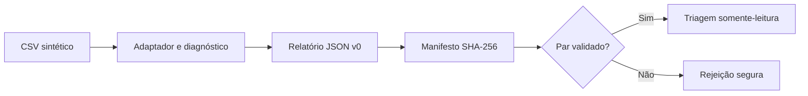

# Agent Lab Pascoal

**Engenharia de confiança para governança de materiais PDM/BOM.**

O Agent Lab Pascoal investiga problemas de qualidade em cadastros industriais e organiza **evidências, recomendações e rastreabilidade**. A decisão cadastral continua com o especialista humano.

[](https://github.com/Jk-Pascoal/agent-lab-pascoal/actions/workflows/tests.yml)

> **Estado verificado em 30/10/2026:** o MVP estrutural CSV sintético está integrado à `main`; último CI confirmado neste checkpoint: **1.242 testes aprovados** ([evidência](https://github.com/Jk-Pascoal/agent-lab-pascoal/actions/runs/41128514860)).
> Essa contagem é um **snapshot**, não um contador atualizado automaticamente. A release `v0.1.0` é histórica, **não** uma versão comercial certificada.

## Que problema resolvemos?

Catálogos industriais podem ter descrições incompletas, inconsistências e materiais potencialmente duplicados. O diagnóstico correto depende de regras explícitas e evidências, não de uma resposta convincente de IA.

O projeto foi desenhado para:

- executar verificações determinísticas e encontrar **candidatos** a duplicidade;
- organizar problemas, evidências e recomendações rastreáveis;
- distinguir uma recomendação automatizada da **decisão humana**;
- registrar limites e resultados verificáveis sem simular maturidade industrial.

## Experimente: PoC sintética em três comandos

**Requisitos:** Python 3.11+, Git e terminal aberto na raiz do repositório. A demonstração usa o CSV sintético versionado, sem ERP ou informações privadas.

```bash
python -m pip install -e .
python scripts/poc_204_demo.py --output-dir poc-204-demo-local
python -m agent_lab.poc_audit_triage poc-204-demo-local/run-1/report.json --actionable-only
```

O segundo comando executa **dois replays físicos determinísticos**, valida relatório e manifesto e gera as evidências. O terceiro mostra as recomendações `REVIEW`/`REJECT` (se presentes) no terminal.

### O que é produzido?

```text
poc-204-demo-local/
├── evidence.json
├── run-1/
│   ├── report.json
│   ├── report.json.manifest.json
│   └── triage.csv
└── run-2/
    ├── report.json
    ├── report.json.manifest.json
    └── triage.csv
```

**Importante:** utilize outro diretório de saída a cada execução. A ferramenta se recusa a sobrescrever relatórios já publicados.

### Verifique a integridade

```bash
python -m agent_lab.poc_audit_verify poc-204-demo-local/run-1/report.json
```

O verificador rejeita pares ausentes, adulterados ou estruturalmente inconsistentes. O manifesto SHA-256 comprova integridade dos **bytes do relatório**, não a autenticidade da origem nem a existência de revisão humana.

### Execute outro CSV de teste

Para dados **sintéticos ou explicitamente autorizados** e compatíveis com o adaptador:

```bash
python -m agent_lab.poc_audit_cli tests/fixtures/poc_204_catalog_synthetic_v1.csv meu-relatorio.json --catalog-id DEMO-LOCAL
python -m agent_lab.poc_audit_verify meu-relatorio.json
python -m agent_lab.poc_audit_triage meu-relatorio.json
```

A CLI grava `meu-relatorio.json` e seu manifesto `meu-relatorio.json.manifest.json`. A triagem é uma **visão somente-leitura** das recomendações automáticas.

## Capacidades implementadas

| Capacidade | Evidência do estágio atual |
|---|---|
| Ingestão CSV | Adaptador físico com validação |
| Diagnóstico de catálogo | Indicadores determinísticos, problemas e candidatos a duplicidade |
| Relatório auditável | JSON versionado, recomendações, evidências e limitações |
| Integridade | Manifesto SHA-256 separado e verificador **fail-closed** |
| Triagem | CSV com recomendações, sem fabricar aprovação humana |
| Demo | Dois replays sintéticos reproduzíveis e casos adversariais |
| Núcleo de governança | Contratos e persistência especializados para workflow, auditoria e revisão humana |

A existência de componentes HITL **não** prova que a PoC CSV já faça a revisão humana ponta a ponta.

### Fluxo demonstrado



A arquitetura separa **Domain, Application, Repository, Projection, Policy e Evaluation**. Contratos detalhados e decisões estão na [documentação técnica](#documentação-e-governança), não nesta introdução.

## Maturidade e limites

**Hoje:** laboratório de engenharia com **MVP estrutural executável em dados sintéticos**. Ainda **não** é uma aplicação industrial ou plataforma operacional pronta.

| Já demonstrado | Ainda não demonstrado/entregue |
|---|---|
| CSV → diagnóstico → relatório → verificação → triagem | Interface de uso para o especialista |
| Replay determinístico e evidência estrutural | Jornada HITL ponta a ponta integrada à PoC |
| Rejeição de par incompleto e testes com `SIGKILL` | Atomicidade/durabilidade em queda de energia |
| Manifesto e relatório com estrutura validada | Custódia dos bytes originais e linhas físicas do CSV |
| Núcleo de governança com contratos separados | Qualidade industrial, escala 100 mil SKUs e integração ERP |

**Fronteiras:** sem prova física de origem, `source_sha256`/`source_row` permanecem `UNAVAILABLE`; sem evento comprovado, `human_review=NOT_RECORDED`. `APPROVE` na recomendação **não** equivale a aprovação humana; pares candidatos não são duplicidades comprovadas.

A [PR #205](https://github.com/Jk-Pascoal/agent-lab-pascoal/pull/205) foi integrada com testes, mas **sem revisão externa independente**. Essa lacuna e os limites R4/R7 permanecem documentados na [Issue #204](https://github.com/Jk-Pascoal/agent-lab-pascoal/issues/204).

**Fora da capacidade operacional atual:** UI Web, provider LLM real integrado, embeddings/RAG, SSO, banco relacional corporativo, ERP/MDM e desempenho industrial validado.

## O caminho para o produto

**Próxima entrega funcional: [Issue #210 — primeira jornada operacional local](https://github.com/Jk-Pascoal/agent-lab-pascoal/issues/210).**

Objetivo: um especialista importa CSV sintético/autorizado, executa diagnóstico real, explora/filtra os problemas e exporta **relatório verificado, manifesto e triagem** por uma interface simples. Critérios de conclusão: código funcional, testes de uso e falha, CI aprovado, demonstração reproduzível e limitações explícitas.

As etapas seguintes incluem revisão humana integrada, avaliação com Ground Truth independente e piloto autorizado. Métricas como precision, recall, falsos negativos, custo ponderado e tempo economizado só devem ser apresentadas após medição adequada.

## Desenvolvimento e testes

O runner canônico é **`unittest`**, não `pytest`.

```bash
python scripts/verify_session_handoff.py
python -m unittest discover -s tests -v
```

O primeiro comando valida o contrato de passagem entre sessões; o segundo executa a suíte geral. Consulte o [CI da `main`](https://github.com/Jk-Pascoal/agent-lab-pascoal/actions/workflows/tests.yml) para obter o resultado atualizado.

Fluxo de engenharia: **Issue → branch → testes → código → PR → CI → revisão exigida → merge**. Nunca antecipar integração apenas para preencher o calendário GitHub.

## Documentação e governança

| Objetivo | Documento |
|---|---|
| Retomar trabalho em novo chat/agente | [AGENTS.md](AGENTS.md) · [SESSION_HANDOFF.json](docs/operations/SESSION_HANDOFF.json) |
| Consultar a fonte de decisões e invariantes | [PROJECT_COMPASS.md](docs/PROJECT_COMPASS.md) |
| Auditar escopo do relatório e limitações | [Revisão técnica #204](docs/planning/POC_204_scoped_technical_acceptance_20261030.md) |
| Acompanhar próxima entrega do produto | [Issue #210](https://github.com/Jk-Pascoal/agent-lab-pascoal/issues/210) |
| Ler arquitetura e histórico detalhados | [README anterior — snapshot integral](docs/history/README_snapshot_20261030_pre_product_focus.md) |
| Consultar padrões e alterações | [CHANGELOG](CHANGELOG.md) · [CONTRIBUTING](CONTRIBUTING.md) · [VERSIONING](VERSIONING.md) |

**Papel de cada documento:** o README apresenta o produto; o Compass mantém o contrato de governança; SPECs e arquivos preservam evidências e história. O handoff é **snapshot**, portanto sempre confira a `main` e o CI antes de qualquer nova atividade.

## Segurança e responsabilidade

Este repositório é público. **Não envie cadastros reais de empresas, credenciais, códigos internos nem dados pessoais sem autorização.** Os exemplos são sintéticos. Nenhum diagnóstico deve alterar automaticamente registros reais.

**Princípio:** a IA organiza evidências e recomenda; **o especialista decide**.
